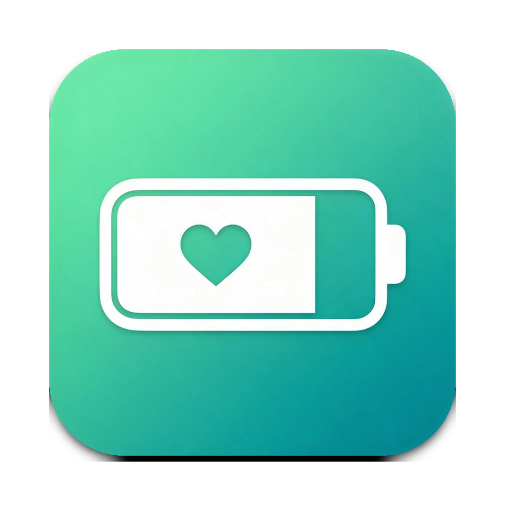
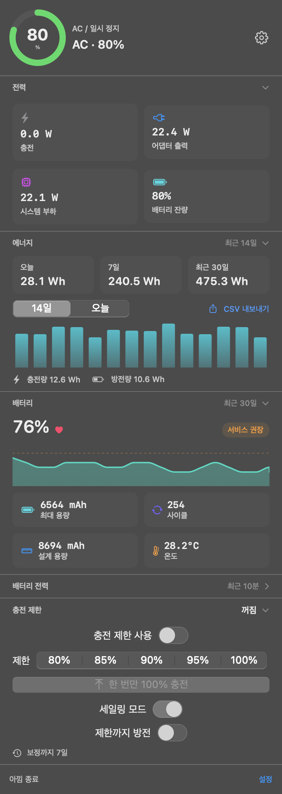
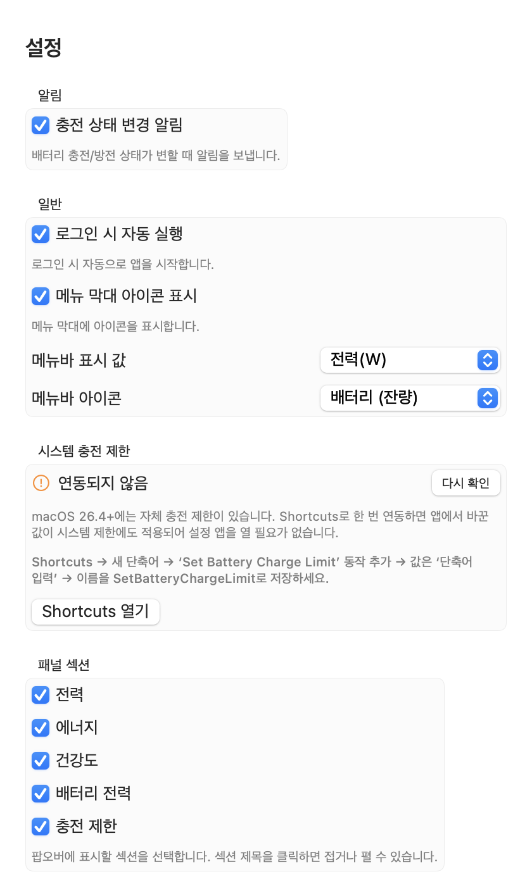

# 아낌 (Akkim)

<p align="center"></p>

A macOS menu bar app that limits battery charging and monitors charging / battery power. It is an independent, AlDente-style charge limiter and is **not affiliated with Al Dente / AppHouseKitchen**.

The name 아낌 (*akkim*) is the Korean noun form of "to save / to cherish" (아끼다) — the idea of sparing the battery rather than keeping it topped up.

<p align="center">
  
  
</p>
<p align="center"><sub>Menu bar panel and settings</sub></p>

> **Continuing on a Mac?** See [docs/HANDOVER.md](docs/HANDOVER.md) for the full handover:
> current status, build/install steps in order, file IPC schemas, a device test checklist,
> troubleshooting, emergency recovery, and remaining work.

## Download

Prebuilt bundles are published on GitHub Releases:

- Latest release: <https://github.com/karanglass24-lang/akkim/releases/latest>
- Direct zip: <https://github.com/karanglass24-lang/akkim/releases/latest/download/Akkim.zip>

Unzip, move `Akkim.app` to `/Applications`, and open it. Release builds are ad-hoc
signed, so the first launch may be blocked (right-click → Open, or
`xattr -dr com.apple.quarantine /Applications/Akkim.app`). The root helper still asks
for admin authorization the first time the charge limit is enabled.

To publish a new build:

```bash
git tag v1.0.0
git push origin v1.0.0
```

The `release` workflow builds on a macOS runner, verifies the bundle, zips it as
`Akkim.zip`, and attaches it (plus a SHA-256 file) to the GitHub Release.

## Features

### Monitoring
- Menu bar status item + modern popover panel
- Live status (charging / AC-paused / discharging / desktop)
- Real-time charging power (W), wall output (W), system load (W), battery level (%)
- Circular battery gauge with charging animation
- **Battery health**: health %, max/design capacity, cycle count, temperature,
  condition, and a 30-day health trend persisted between launches
- **Battery power + state-of-charge history** (last ~10 min, Swift Charts); the
  SoC chart overlays the current limit and sailing lower bound
- **Pause reason** from the helper (`holding at limit`, `too hot`, `calibrating`,
  `topping up`, `discharging`, `adapter not connected`)
- **Energy use**: daily / 7-day / 30-day AC energy totals (Wh or kWh), a 14-day bar
  chart, today's hourly view, today's charged / discharged energy, and CSV export.
  Totals cover time while the app is running (sleep and quit gaps are ignored).

### Charging Limit
- **Linking the macOS 26.4+ system Charge Limit** through a one-time Shortcuts
  shortcut lets the app update the system limit itself — no trip to System Settings
- Apple Silicon Mac (M1–M4), macOS 13+
- macOS 26.4+: native battery charge limit bridged via a Shortcuts action (`SetBatteryChargeLimit`)
- Fallback: SMC charge-control keys (`CHTE` / `CHIE`) via a root LaunchDaemon helper
- Explicit **on/off switch** for the limit; turning it back on restores the last step
- **Sailing mode**: hold at limit, recharge after dropping below `limit - deadband`
- **Hard-stop mode** (sailing off): hold at limit, recharge whenever below limit
- **Discharge mode**: disconnect the adapter (CHIE) and discharge down to the limit
- **One-shot top-up**: charge to 100% once (great before a trip), then restore the limit
- **Heat protection**: pause charging above a configurable battery temperature (0 = off)
- Auto full-charge calibration (0/7/14/30/60 days) with last-full-charge tracking
- Fail-safe: charging restored on helper exit / crash / signal

### Menu bar
- **Battery icon**: drawn to match the system indicator — the fill follows the charge
  level and a lightning bolt is cut out while charging; template image adapts to
  light/dark menu bars
- **Icon style**: battery (charge level), charging battery, or power plug, chosen in Settings
- **Right-click quick menu**: 80/85/90/95/100%, off, settings, quit
- **Display options**: power (W), battery (%), icon only, or temperature

### Settings
- Notifications on/off, launch at login (`SMAppService`), menu bar icon visibility
- Menu bar display mode (power / percent / icon only / temperature), icon style
  (battery / charging battery / plug), calibration interval, deadband, sailing mode, discharge mode
- Heat-protection threshold (30–60℃)
- Panel sections: show/hide power, battery health, history, and charge-limit controls;
  click a section title in the popover to collapse or expand it (state is remembered)

### Language
- The UI follows the macOS system language
- `ko*` → Korean, any other language → English
- The language is resolved once at launch, so restart the app after changing the system language
- All strings live in `Sources/Akkim/Localization.swift`; `LKey.text` is an exhaustive
  switch, so adding a key without both translations does not compile
- Error messages shown in the panel are localized too (`ChargeLimitError: LocalizedError`)

## Requirements

- macOS 13+, Apple Silicon (M1–M4)
- Xcode 15+ (Swift 5.9; to build)
- SMC helper: root privileges via LaunchDaemon; `CHTE` or `CHIE` key availability depends on the machine

## Build

### Option A — Package as a .app (recommended)

```bash
cd akkim
chmod +x scripts/package-app.sh scripts/install-helper.sh
bash scripts/package-app.sh          # release build -> dist/Akkim.app
open dist/Akkim.app
```

The script builds both executables, copies the helper + install script and the
license files into `Akkim.app/Contents/Resources`, writes `Info.plist`
(`LSUIElement`, bundle id), and ad-hoc codesigns the bundle.

### Option B — Open in Xcode

Open the `akkim/` folder in Xcode (SwiftPM). Build the `Akkim`
scheme (app) and the `akkim-helper` product (helper).

### Option C — Compile check in CI

`.github/workflows/build.yml` runs on a `macos-14` (Apple Silicon) runner for every
push and pull request: `swift build` (debug + release), `scripts/package-app.sh`,
and an assertion that the bundle contains `LICENSE`, `THIRD-PARTY-NOTICES.md`, and
the expected `Info.plist` values. The packaged `dist/Akkim.app` is uploaded as a
build artifact. Use the workflow run log to catch compile errors when you do not
have a Mac at hand.

## Install helper (first enable)

The app triggers installation via admin authorization. To install manually:

```bash
bash scripts/install-helper.sh install "dist/Akkim.app/Contents/Resources/akkim-helper"
bash scripts/install-helper.sh uninstall
```

Config file: `/Users/Shared/Akkim/smc-limit.json`

```json
{"schemaVersion":1,"enabled":true,"limit":80,"deadband":5,"calibrationDays":7,"sailingMode":true,"discharge":false,"heatProtectionC":0,"topUp":false}
```

- `heatProtectionC`: pause charging at or above this battery temperature
  (`0` = off, valid range 30–60).
- `topUp`: one-shot request. The daemon charges to 100%, then rewrites the file
  with `topUp:false`; a top-up also enables the limit (`enabled:true`) so it can
  be enforced afterwards.
- The app writes this file atomically, and the daemon keeps the last readable
  config for up to 60 seconds before giving up, so a torn read can no longer
  release the charge limit by accident.
- The file lives in a `root:admin` directory with mode `775`, and the JSON is
  `664` — writable by admin users (the app), never world-writable. Installs made
  before this change are hardened automatically when the daemon starts.
- A helper installed under the old name (`com.batterylimit.helper`) is removed
  automatically by `install-helper.sh`, so two daemons cannot fight over CHTE.

### Helper state (`/Users/Shared/Akkim/helper-state.json`)

The daemon publishes what it is doing every ~10 s so the app can explain pauses
and hide unsupported controls:

```json
{"schemaVersion":1,"ts":1767225600,"holding":true,"discharging":false,
 "actuator":"CHTE","chieAvailable":true,"soc":80,"tempC":33.4,
 "reason":"limit","enabled":true,"limit":80,"topUp":false}
```

- `reason`: `off`, `noBattery`, `adapterOff`, `discharge`, `topUp`, `heat`,
  `calibration`, `limit`, `charging`.
- The app treats a state file older than 30 s as stale ("helper not responding").
- `chieAvailable:false` disables the discharge toggle automatically.

## Notes

- **Xcode is required**: this project uses AppKit, SwiftUI, Swift Charts and IOKit.
  It cannot be built on Windows.
- **Shortcuts bridge (macOS 26.4+)**: create a shortcut named `SetBatteryChargeLimit`
  in Shortcuts before using the native path. The app shows an onboarding prompt.
- **Discharge mode** requires the `CHIE` SMC key; on machines without it the toggle
  is disabled automatically (the helper reports `chieAvailable:false`).
- **Top-up and heat protection** require the SMC helper (the Shortcuts-only path
  has no daemon loop to enforce them).
- **Quitting the app keeps the limit enforced** (the helper daemon keeps the last
  config). Turn the limit off in the panel to restore normal charging.
- **Upgrading**: reinstall the helper once after updating the app
  (`bash scripts/install-helper.sh install …`) so the daemon starts publishing
  `helper-state.json`; otherwise the panel shows "helper is not responding".
- **Codesigning**: ad-hoc signing is used for personal use. For distribution use a
  Developer ID and notarization.

## Safety

- Use at your own risk; do not keep the battery at 100% for extended periods.
- The helper restores charging on exit/crash/signal.
- SMC writes require root; the helper runs as a LaunchDaemon.
- Writing undocumented SMC keys can affect charging behavior and battery
  health. Test on your own hardware. The software is provided "as is",
  without warranty of any kind (see `LICENSE`).

## License

MIT — see [LICENSE](LICENSE).

Akkim is a derivative work based on
[ChargeWatching](https://github.com/TY-teo/ChargeWatching) (MIT,
Copyright (c) 2026 TY-teo). Substantial portions of the code are derived from
that project. The required copyright and permission notice is reproduced in
`LICENSE` and in `THIRD-PARTY-NOTICES.md`, and is bundled inside
`Akkim.app/Contents/Resources`.

## Credits

- [ChargeWatching](https://github.com/TY-teo/ChargeWatching) — original
  implementation this project is derived from (MIT).
- [batt](https://github.com/actuallymentor/battery) — reference for the
  documented SMC charge-control mechanism (MIT).
- [SMCKit](https://github.com/beltex/SMCKit) — reference for the public
  AppleSMC interface (MIT).

See [THIRD-PARTY-NOTICES.md](THIRD-PARTY-NOTICES.md) for details. "Al Dente"
is a trademark of AppHouseKitchen; this project is not affiliated with it.
